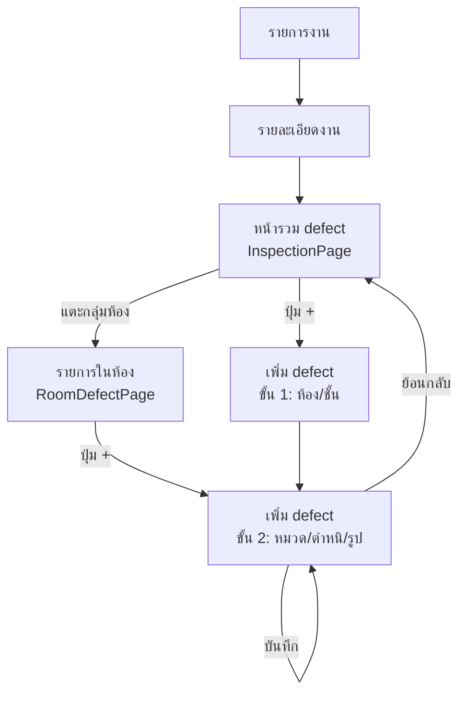

# Simulate: การตรวจ Defect (ความเร็ว)

> วันที่: 23/11/2026 · branch `feat/cons-task-tracking`
> วิธี: `skills/simulate/SKILL.md` (persona เดินผ่าน scenario, tag ปัญหาด้วย H1–H10 / A1–A15 จาก `skills/accessibility.md`) แล้วยืนยันทุกข้อกับโค้ดจริง
> Pain point: **ช้า** · เป้าหมาย: **ความเร็ว**

---

## Simulation setup

| Persona | ลักษณะ | ทำไมเลือก |
|---|---|---|
| **P1 Inspector หน้างาน** | ถือมือถือข้างเดียว เดินห้องต่อห้อง สัญญาณ 4G ไม่นิ่ง | ผู้ใช้หลักของ flow นี้ ความช้ากระทบตรงที่สุด |
| **P2 Inspector มือใหม่, tech comfort ต่ำ** | ไม่รู้ว่าระบบกำลังบันทึกเบื้องหลัง ไม่แน่ใจว่ากดไปแล้วหรือยัง | ใช้ตรวจ feedback/สถานะ (H1) |
| **P3 Inspector ตรวจซ้ำ (Verify)** | กลับมาตรวจงานซ่อม ดูรูปก่อน/หลัง | ใช้ตรวจหน้า verify ที่โหลดรูปใหญ่ |

**Scenario หลัก:** บันทึก defect ~30 จุดในบ้าน 1 หลัง หลายห้อง หลายชั้น มีรูปทุกจุด

---

## Session results

### P1: Inspector หน้างาน: Partial (ทำสำเร็จแต่ช้ามาก)
1. แตะ `+` บนหน้ารวม → ต้องกาง FAB ก่อนแล้วแตะอีกครั้ง (2 แตะ)
2. หน้าเพิ่ม defect ขึ้น **loader ขาวเต็มจอ** รอ `/rooms` → `/sub-rooms` → `/floor` ทีละตัว และดึงข้อมูลรอบเดิมซ้ำ 3 ครั้ง (7–8 requests ทุกครั้งที่เปิด)
3. เลือกห้อง ชั้น ถัดไป หมวด ตำหนิ ถ่ายรูป บันทึก ≈ 16 แตะ
4. บันทึกแล้วจะบันทึกจุดถัดไปในห้องเดิม: ตำหนิ+หมายเหตุยังค้าง **ตัวเช็คซ้ำบล็อก** ต้องล้างแล้วเลือกใหม่
5. ทุกครั้งที่บันทึก ระบบดึง defect **ทั้งรอบ** ใหม่ (ยิ่งตรวจมาก ยิ่งช้า)
6. ย้อนกลับหน้ารวม → loader เต็มจออีกรอบ ดึงทั้งรอบใหม่
7. สัญญาณหลุดกลางทาง → request ค้างไม่มี timeout การ์ดหมุน "กำลังบันทึก" ไม่จบ

### P2: มือใหม่: Partial
- บันทึกแล้วไม่มีข้อความยืนยัน มีแค่รูปหายไป ไม่แน่ใจว่าบันทึกแล้วหรือยัง (H1)
- defect แรกของห้องใหม่ไม่โผล่ในหน้ารายการจนกว่าจะโหลดทั้งรอบเสร็จ (H1)

### P3: ตรวจซ้ำ: Partial
- หน้า verify โหลดรูปต้นฉบับ 1920px ทั้งก่อน/หลัง กด "ผ่าน" แล้วรอดึงทั้งรอบใหม่ก่อนย้อนกลับ

---

## Issue summary

| # | Severity | ปัญหา | หลักฐาน | Tag |
|---|---|---|---|---|
| C1 | Critical | หน้าเพิ่ม defect รอ master data 3 ตัวทีละตัว + ดึงรอบซ้ำ 3 ครั้ง ทุกครั้งที่เปิด | `Frontend/src/pages/AddDefectPage.vue` (onMounted), `composables/useRoundLock.ts` | H1, H7 |
| C2 | Critical | บันทึกแต่ละจุด = ดึง defect ทั้งรอบใหม่ (8 relations ไม่มี pagination) | `stores/useInspection.ts` (runDefectSync), `backend/src/defects/defects.service.ts` (findByRound) | H7 |
| C3 | Critical | ย้อนกลับหน้ารวม = loader เต็มจอ + ดึงทั้งรอบใหม่ | `pages/InspectionPage.vue` | H1, H7 |
| C4 | Critical | backend บีบอัด+อัปโหลดรูป **ก่อน** เช็ครอบล็อก/ซ้ำ ไม่มี limit ขนาดไฟล์ | `backend/src/defects/defects.controller.ts` | – |
| C5 | Critical | ไม่มี index ที่ foreign key ใดเลย (`defect.round_id`, ตารางที่ guard สิทธิ์ใช้ทุก request) | entities ทั้งหมด | – |
| H1 | High | รายการแสดงรูปต้นฉบับ 1920px ในกล่อง 130px | `components/DefectDetailCard.vue`, `pages/VerifyDefectPage.vue`, `components/PlanPositionDialog.vue` | H7 |
| H2 | High | หลังบันทึก ตำหนิ+หมายเหตุค้าง ทำให้เช็คซ้ำบล็อกจุดถัดไป | `pages/AddDefectPage.vue` | H5, H9 |
| H3 | High | ไม่จำห้อง/ชั้น/หมวด/แปลนข้ามการเปิดหน้า | `pages/AddDefectPage.vue` | A14, H6 |
| H4 | High | list defect ส่ง **password hash** ของ inspector และแถวรอบตรวจ (token ลูกค้า/ช่าง) ซ้ำทุกแถว | `backend/src/users/entities/user.entity.ts`, `defects.service.ts` | ความปลอดภัย |
| H5 | High | axios ไม่มี timeout | `boot/axios.ts` | H1, H9 |
| H6 | High | guard ของ inspector ยิงได้ถึง 7 query (4 รอบต่อเนื่อง) ทุก request | `backend/src/auth/auth.service.ts` | – |
| H7 | High | ไม่มี toast ยืนยัน, การ์ดกำลังบันทึกไม่ขึ้นในห้องที่ยังไม่มี defect | `pages/RoomDefectPage.vue` | H1 |
| L1 | Low | FAB ต้องแตะ 2 ครั้ง | `components/ActionFab.vue` | H7 |
| L2 | Low | วาดบนรูปแล้วรูปถูกย่อเหลือขนาดจอ + export รูปต้นฉบับ/ข้อมูลวาดที่ไม่เคยถูกส่ง | `composables/useFabricCanvas.ts`, `components/ImageAnnotatorDialog.vue` | – |
| L3 | Low | fabric.js โหลดทุกครั้งที่เปิดหน้า แม้ไม่ได้วาด | `pages/AddDefectPage.vue` | – |
| L4 | Low | คิว retry อยู่ใน memory ปิดแอป = defect ที่ยังไม่ส่งหาย | `stores/useInspection.ts` | H9 |
| L5 | Low | ส่ง `inspectorId` เป็น `'1'` ตายตัวทุก defect (ผิดคนบันทึก) | `pages/AddDefectPage.vue` (`// TODO: ดึงจาก auth store`) | ความถูกต้องข้อมูล |

---

## Predicted success rate

| Persona | บันทึก 30 จุด | ย้อนกลับ/สลับห้อง | ตรวจซ้ำ (verify) |
|---|---|---|---|
| P1 หน้างาน | Partial | Partial | - |
| P2 มือใหม่ | Partial | Partial | - |
| P3 ตรวจซ้ำ | - | Partial | Partial |

---

## Recommended fixes (ทำแล้วในรอบนี้)

| ปัญหา | สิ่งที่แก้ | ไฟล์หลัก |
|---|---|---|
| C1 | master data (หมวด/หมวดย่อย/ห้อง/ห้องย่อย/ชั้น) โหลดพร้อมกันครั้งเดียวต่อ session เก็บใน store, ข้อมูลรอบ cache ร่วมกันทุกหน้า (60 วินาที, ล้างทันทีเมื่อ submit/confirm/approve จากเครื่องนี้), ไม่มี loader เต็มจอ | `stores/useInspection.ts`, `composables/useRoundLock.ts`, `pages/AddDefectPage.vue` |
| C2 | backend ตอบ defect ที่สร้างในรูปร่างเดียวกับ list แล้ว frontend ใส่ลง store เลย ไม่ดึงทั้งรอบ, ลบ/verify ก็อัปเดตใน store ตรงๆ | `defects.controller.ts`, `defects.service.ts` (`findListItem`), `stores/useInspection.ts` |
| C3 | หน้ารวมแสดง list ที่มีอยู่ทันทีแล้ว refresh เบื้องหลัง loader เฉพาะครั้งแรกของรอบ และอุ่น master data ไว้ล่วงหน้า | `pages/InspectionPage.vue` |
| C4 | เช็ครอบล็อก+ซ้ำก่อน แล้วค่อยอัปโหลดรูป, จำกัดไฟล์ 15MB | `defects.controller.ts`, `defects.service.ts` |
| C5 | `@Index` บน FK ที่ใช้บ่อย + สคริปต์สำหรับ production | entities, `backend/scripts/add-fk-indexes.sql` |
| H1 | ใช้รูปย่อจาก `/images/thumb` (400px ในการ์ด/แปลน, 600px หน้า verify) + `loading="lazy"` | `utils/thumb.ts`, `DefectDetailCard.vue`, `VerifyDefectPage.vue`, `PlanPositionDialog.vue` |
| H2, H3 | หลังบันทึกคงห้อง/ชั้น/หมวด/แปลน ล้างตำหนิ/หมายเหตุ/รูป/หมุด, จำตำแหน่งล่าสุดต่อรอบ เปิดจากหน้ารวมแล้วไปขั้น 2 ทันที มี chip แสดงห้อง/ชั้น + ปุ่ม "เปลี่ยนห้อง/ชั้น" | `pages/AddDefectPage.vue`, i18n `inspection.ts` |
| H4 | `password` เป็น `select: false` (login ใช้ `findByEmailWithPassword`), list ไม่ join แถวรอบ เรียงตาม `defectId` | `user.entity.ts`, `users.service.ts`, `auth.service.ts`, `defects.service.ts` |
| H5 | timeout 20 วินาทีสำหรับ request ใน flow ตรวจ, 60 วินาทีสำหรับอัปโหลดรูป (ใส่ราย request ไม่กระทบงานสร้าง PDF/อัปโหลดแปลน) | `boot/axios.ts`, `stores/useInspection.ts` |
| H7 (บางส่วน) | การ์ดกำลังบันทึกจับคู่ด้วย group key จึงขึ้นได้แม้เป็นจุดแรกของห้อง ส่วนข้อความยืนยันการบันทึกยังไม่ได้ทำ เพราะทีมปิด toast ทั้งแอปไว้ (`boot/notify.ts`) ต้องออกแบบเป็นข้อความในหน้าแทน | `pages/RoomDefectPage.vue` |
| L1 | FAB เป็นปุ่มเดียว แตะครั้งเดียว | `components/ActionFab.vue` |
| L2, L3 | วาดแล้ว export ที่ความละเอียดเดิม (ไม่เกิน 1920px), ตัด export ที่ไม่ได้ใช้, โหลดตัววาดเฉพาะตอนเปิดใช้ | `useFabricCanvas.ts`, `ImageAnnotatorDialog.vue`, `AddDefectPage.vue` |

### ผลที่คาดไว้ (คำนวณจากโค้ด ยังไม่ได้วัดบนเครื่องจริง)

| วัดอะไร | ก่อน | หลัง |
|---|---|---|
| requests ตอนเปิดหน้าเพิ่ม defect | 7–8 (3 ตัวเรียงกัน, blocking) | 0 เมื่อมี cache (ครั้งแรก 5 ตัวพร้อมกัน, ไม่ blocking) |
| requests หลังบันทึก 1 จุด | POST + GET ทั้งรอบ | POST อย่างเดียว |
| ย้อนกลับหน้ารวม | loader เต็มจอ + GET ทั้งรอบ | แสดงทันที, GET เบื้องหลัง |
| แตะต่อ defect จากหน้ารวม (ห้องเดิม) | ≈ 16 | ≈ 8 (FAB 1 + ตำหนิ 3 + รูป 3 + บันทึก 1) |
| รูปในการ์ดรายการ | ต้นฉบับ ≤1920px | รูปย่อ 400px |

### ผลวัดจริง (23/11/2026)

ทดสอบใน browser ขนาด 375×812 กับ Supabase โปรเจกต์ใหม่ (`pwjxgoybmcnxmnoabjye`) บัญชี admin งานทดสอบ "เทส1111" (รอบ 85) นับ request ไปที่ API ด้วย Resource Timing รันโดยปิด `synchronize` จึงยังไม่มี index ใหม่ใน DB ผลด้านล่างจึงยังไม่รวมผลของ index ฝั่ง backend

| วัดอะไร | ผลวัด | เป้า |
|---|---|---|
| เปิดหน้าเพิ่ม defect (หลังเข้าหน้ารวมแล้ว) | **0 requests**, ไม่มี loader เต็มจอ | 0–1 ✅ |
| บันทึก defect | **1 request** (`POST /defects` ~1.2–1.3 วินาที) ไม่มีการดึงทั้งรอบ, defect ใหม่เข้า list ทันที | 1 ✅ |
| response ของ defect | ไม่มี `round`, inspector ไม่มี `password` | ✅ |
| บันทึกจุดถัดไปในห้องเดิม | ไม่ถูกเช็คซ้ำบล็อก, ห้อง/ชั้น/หมวดยังอยู่, **4 แตะ** (เปิดรายการตำหนิ, เลือก, ปิด, บันทึก) ไม่รวมถ่ายรูป | ≤ 8 ✅ |
| ย้อนกลับหน้ารวม | list ขึ้น **ทันที (0 ms)** ไม่มี loader, refresh เบื้องหลัง 2 requests | ✅ |
| กด + จากหน้ารวมครั้งถัดไป | **0 requests**, ไปขั้น 2 เลยพร้อม chip "ห้องนอนใหญ่ · ชั้น 1" และหมวดเดิม | ✅ |
| รูปย่อในรายการ | ❌ ได้รูปต้นฉบับกลับมา เพราะอัปโหลดรูปย่อขึ้น Storage ไม่ผ่าน ("Invalid Compact JWS") ดูหัวข้อถัดไป | 400px |

defect ทดสอบ 2 รายการ (378, 379) ลบแล้ว รอบ 85 กลับเป็นเหมือนเดิม (มี activity log "พบข้อบกพร่องใหม่" ค้างอยู่ 2 รายการ)

### สิ่งที่พบระหว่างทดสอบ (ไม่ได้เกิดจากการแก้รอบนี้)
- **Storage ใช้ key รูปแบบใหม่ไม่ได้:** `SUPABASE_SERVICE_ROLE_KEY` เป็น `sb_secret_...` แต่ Storage ตอบ "Invalid Compact JWS" ทำให้ทั้ง**อัปโหลดรูป defect** และรูปย่อพังบนโปรเจกต์ใหม่ น่าจะแก้ได้ด้วย key `service_role` แบบเดิม (JWT) จาก Project Settings → API Keys → Legacy API keys
- **`DB_HOST` ที่ถูกคือ `aws-0-ap-southeast-1.pooler.supabase.com`** (`aws-1-...` หาโปรเจกต์ไม่เจอ)
- PDF รายงานสร้างไม่ได้ในการทดสอบนี้เพราะ Puppeteer เปิด `localhost:9000` แต่ทดสอบ frontend ที่พอร์ต 9100 (เฉพาะสภาพแวดล้อมทดสอบ)

---

## Follow-ups (ยังไม่ทำ)
- **H7:** ข้อความยืนยันว่าบันทึกแล้วแบบอยู่ในหน้า (เช่น "บันทึกแล้ว N จุดในห้องนี้") เพราะ toast ถูกปิดทั้งแอป
- รัน `backend/scripts/add-fk-indexes.sql` บนโปรเจกต์ Supabase ใหม่ แล้ววัด `POST /defects` และ list อีกครั้ง
- **L4:** เก็บคิว defect ที่ยังส่งไม่สำเร็จลง IndexedDB (ไม่ขัดกับ "never autosave" ใน `skills/design_thinking.md` เพราะเก็บเฉพาะที่กด Save แล้ว)
- **H6:** รวม query ใน guard ของ inspector เป็น `EXISTS` เดียว
- **L5:** ส่ง `inspectorId` จากผู้ใช้ที่ login (หรือให้ backend ใช้ `request.user.sub`)
- `POST /defects` ยังไม่มี round-access guard (inspector สร้าง defect ในรอบที่ไม่ได้รับมอบหมายได้)
- ย้าย Puppeteer/AI regen ออกจาก process ของ API
- ทดลอง "ถ่ายรูปก่อน" (camera-first) กับ inspector จริงตาม `skills/test`

## Next step
รัน backend + frontend แล้ววัดตามตาราง "ผลที่คาดไว้" บนมือถือจริง (หรือ browser 375×812) จากนั้นให้ inspector จริงลองบันทึก 10 จุดเทียบเวลาก่อน/หลัง ตาม `skills/test/SKILL.md`
