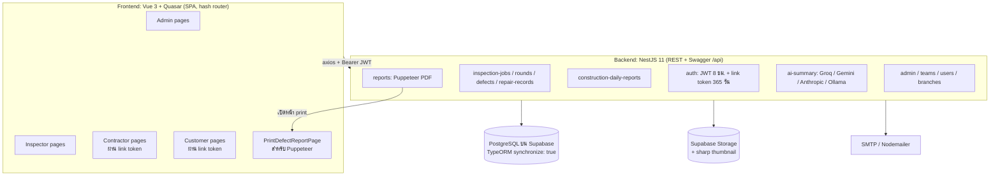
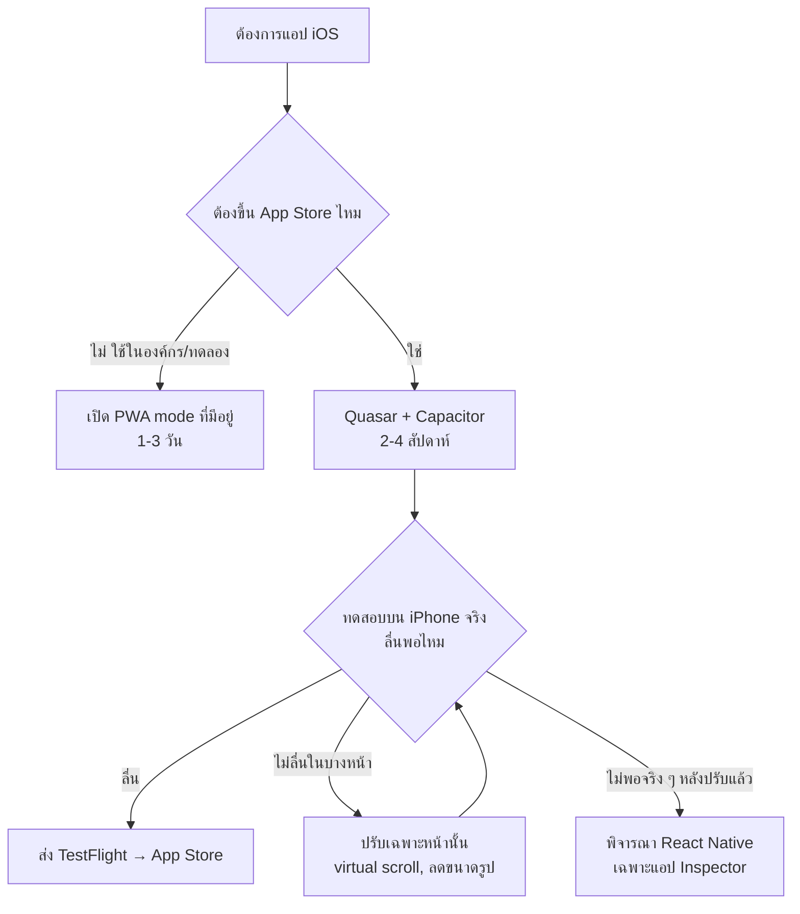
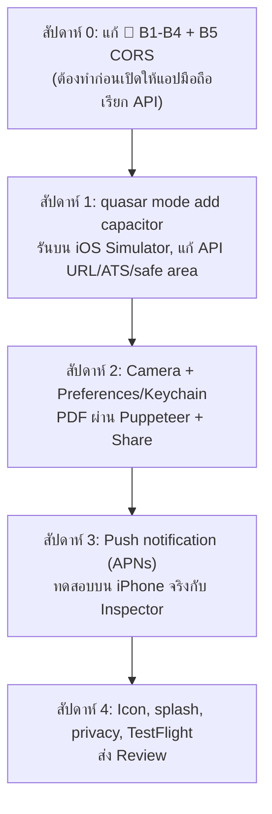

# HIDS: ตรวจโครงสร้างระบบ จุดที่ควรปรับปรุง และแนวทางทำแอป iOS

> วันที่ตรวจ: 23/11/2026 · branch `feat/cons-task-tracking` (commit `4619795`)
> รูปแบบเอกสาร: แผนภาพใช้ Mermaid `flowchart TD` ตาม `skills/diagrams/SKILL.md` และ `skills/ideate/mermaid/SKILL.md` ภาษาไทยอิง `skills/ux-writing/references/thai.md`

---

## 1. สรุปสั้น

| หัวข้อ | ผล |
|---|---|
| โครงสร้างโดยรวม | ดี แบ่งเป็น NestJS module ตาม domain ชัดเจน ฝั่ง Frontend เป็น Quasar + Pinia แยกหน้าตามบทบาท |
| ความเสี่ยงสูงสุด | `synchronize: true` ของ TypeORM, controller 5 ตัวที่ไม่มี guard, CORS เปิดทุก origin, ValidationPipe ไม่กรอง field ส่วนเกิน |
| หนี้ทางเทคนิค | ไฟล์ใหญ่มาก (Vue 2,000+ บรรทัด, service 1,200+ บรรทัด), PDF มี 4 วิธีปนกัน, Frontend ไม่มี test และไม่มี CI |
| iOS | **ไม่ต้องเขียนใหม่เป็น React Native หรือ Flutter** Quasar รองรับ build เป็นแอป iOS ผ่าน **Capacitor** ได้โดยตรง ใช้โค้ด Vue เดิมเกือบทั้งหมด |

---

## 2. โครงสร้างระบบปัจจุบัน



ตัวเลขจากโค้ด

| | Backend | Frontend |
|---|---|---|
| ไฟล์โค้ด | 212 ไฟล์ `.ts` (~14,600 บรรทัด) | 87 ไฟล์ `.vue` (~36,500 บรรทัด) |
| Test | 66 ไฟล์ `.spec.ts` + GitHub Actions | ไม่มี (`"test": "echo \"No test specified\""`) |
| Module / Store | 33 module | 20 Pinia store |

---

## 3. จุดที่ควรปรับปรุง

เรียงตามความสำคัญ: 🔴 ควรแก้ก่อนขึ้น production · 🟠 ควรแก้เร็ว · 🟡 ปรับเมื่อมีเวลา

### 3.1 Backend: ความปลอดภัยและข้อมูล

| # | ระดับ | ปัญหา | ตำแหน่ง | แนวทางแก้ |
|---|---|---|---|---|
| B1 | 🔴 | `synchronize: true` ทำงานทุก environment ถ้าแก้ entity (เปลี่ยนชื่อ/ลบคอลัมน์) TypeORM จะ drop คอลัมน์ใน DB จริงและข้อมูลหาย | `backend/src/app.module.ts:129` | ตั้ง `synchronize: configService.get('NODE_ENV') !== 'production'` ทันที แล้วย้ายไปใช้ TypeORM migrations (`typeorm migration:generate`) แทนสคริปต์ SQL ใน `backend/scripts/` |
| B2 | 🔴 | Controller ไม่มี `@UseGuards` เลย ใครก็เรียก CRUD ได้โดยไม่ login รวมถึง `DELETE` | `addresses`, `floor`, `repair-records`, `assignments`, `inspection-team-members` | ใส่ `AuthGuard` ระดับ class หรือดีกว่านั้นคือทำ **global guard** (`APP_GUARD`) แล้วใช้ decorator `@Public()` เฉพาะ endpoint ที่ตั้งใจเปิด เช่น `images/thumb`, login |
| B3 | 🔴 | Controller 2 ตัวใช้ path เดียวกัน `@Controller('assignments')` และมี route ซ้ำ (`POST /`, `GET job/:job_id`, `DELETE :id`) ตัวที่ register ก่อนจะชนะ อีกตัวกลายเป็นโค้ดตาย | `assignments.controller.ts:15`, `inspection-team-members.controller.ts:15` | เปลี่ยน path ของ `inspection-team-members` หรือรวมเป็น module เดียว |
| B4 | 🔴 | `ValidationPipe({ transform: true })` ไม่มี `whitelist` ผู้ใช้ส่ง field ที่ไม่อยู่ใน DTO (เช่น `role`, `branchId`) เข้าไปถึง entity ได้ (mass assignment) | `backend/src/main.ts:21` | `new ValidationPipe({ transform: true, whitelist: true, forbidNonWhitelisted: true })` |
| B5 | 🟠 | `app.enableCors()` เปิดให้ทุก origin | `backend/src/main.ts:19` | กำหนด `origin` เป็น list จาก env (`FRONTEND_URL` + `capacitor://localhost` เมื่อทำ iOS) |
| B6 | 🟠 | ไม่มี rate limit ที่ `/auth/login` และไม่มี security headers | ทั้งระบบ | เพิ่ม `@nestjs/throttler` (เช่น 5 ครั้ง/นาทีที่ login) และ `helmet` |
| B7 | 🟠 | Link token ของ customer/contractor อายุ 365 วัน ถ้าลิงก์หลุดจะใช้ได้ทั้งปี | `backend/src/auth/auth.service.ts:19-20` | ลดอายุให้ผูกกับอายุงาน หรือเก็บ `jti` ใน DB เพื่อเพิกถอน (revoke) ได้ ตรวจว่ามีปุ่มยกเลิกลิงก์อยู่แล้วหรือยัง |
| B8 | 🟠 | Swagger `/api` เปิดใน production | `backend/src/main.ts:17` | เปิดเฉพาะเมื่อ `NODE_ENV !== 'production'` |
| B9 | 🟡 | DB SSL ใช้ `rejectUnauthorized: false` | `backend/src/app.module.ts:90` | ใส่ CA ของ Supabase แล้วตั้งเป็น `true` |
| B10 | 🟡 | อ่าน `process.env` ตรง ๆ หลายจุด และไม่มี schema ตรวจ env ตอนบูต | หลายไฟล์ | ใช้ `ConfigService` อย่างเดียว + `validationSchema` (Joi/zod) ให้แอปล้มตั้งแต่เริ่มถ้าขาดค่า |
| B11 | 🟡 | ลิสต์ entity ด้วยมือ 33 ตัวใน `app.module.ts` | `app.module.ts:95-127` | `autoLoadEntities: true` |

### 3.2 Backend: โครงสร้างโค้ด

| # | ระดับ | ปัญหา | แนวทางแก้ |
|---|---|---|---|
| B12 | 🟠 | `admin.service.ts` 1,262 บรรทัด, `inspection-rounds.service.ts` 698, `reports.service.ts` 640 | แยกตาม use case เช่น `admin-jobs.service`, `admin-dashboard.service`, `admin-users.service` |
| B13 | 🟡 | ServeStatic `uploads/` ยังอยู่ทั้งที่รูปย้ายไป Supabase Storage แล้ว | ถ้าไม่มีไฟล์เก่าค้างใน `uploads/` ให้ลบออก |
| B14 | 🟡 | ไม่มี health check จริงและ structured logging | `@nestjs/terminus` + logger ที่ออก JSON |

### 3.3 Frontend

| # | ระดับ | ปัญหา | ตำแหน่ง | แนวทางแก้ |
|---|---|---|---|---|
| F1 | 🟠 | Component ใหญ่เกินดูแล | `DefectReport.vue` 2,423 · `AdminJobInsDetailPage.vue` 2,068 · `AdminCreateJobPage.vue` 1,746 · อีก 8 ไฟล์เกิน 1,000 บรรทัด | แตก section เป็น component ย่อย ย้าย logic ไป composable/store (โปรเจกต์มี `composables/` อยู่แล้ว ใช้ต่อได้) |
| F2 | 🟠 | ทำ PDF 4 วิธีปนกัน: Puppeteer (backend), `jspdf`, `pdfmake`, `html2canvas`, และ `window.open` + print | `ConstructionReportPdf.vue:262` ฯลฯ | รวมเหลือ **Puppeteer ฝั่ง backend อย่างเดียว** ได้ไฟล์เหมือนกันทุกอุปกรณ์ ลด bundle size และเป็นวิธีเดียวที่ทำงานใน iOS app (ดูข้อ 4.4) |
| F3 | 🟠 | ไม่มี test และไม่มี CI ฝั่ง Frontend | `Frontend/package.json` | เพิ่ม Vitest สำหรับ store/composable + workflow `frontend-ci.yml` รัน `lint` + `vue-tsc` + `build` |
| F4 | 🟠 | เก็บ JWT ใน `LocalStorage` (ถ้ามี XSS จะถูกขโมย token ได้) และไม่มี refresh token พอครบ 8 ชม. ผู้ใช้ถูกเด้ง logout กลางงานตรวจ | `stores/useAuth.ts:29-30`, `boot/axios.ts` | ระยะสั้น: เพิ่ม refresh token · บน iOS: ย้ายไป Keychain (ดูข้อ 4.4) |
| F5 | 🟡 | โค้ดตัวอย่าง/ทดสอบค้างอยู่ และ `/dashboard` ยังชี้ไป `DashboardTestPage.vue` | `routes.ts:34`, `ExampleComponent.vue`, `example-store.ts` | ลบหรือย้ายออกจาก route จริง |
| F6 | 🟡 | ตั้งชื่อ store ไม่สม่ำเสมอ | `useContractormain.ts`, `useDefectlist.ts` | `useContractorMain.ts`, `useDefectList.ts` |
| F7 | 🟡 | Profile page ทำ `localStorage.clear()` เอง แทนเรียก `auth.logout()` | `AdminProfilePage.vue:474`, `InspectorProfilePage.vue:434` | เรียกผ่าน store เพื่อให้ logout มีที่เดียว |

### 3.4 Repo และเอกสาร

- `backend/BACKEND_ARCHITECTURE.md`, `Frontend/FRONTEND_ARCHITECTURE.md`, `DESIGN_BLUEPRINT_*.md`, `skills/` ยังไม่ได้ commit
- มี `package-lock.json` ขนาด 97 bytes ที่ root โดยไม่มี `package.json` ลบได้
- CI มีแค่ backend และรันเฉพาะ branch `main`

---

## 4. ทำแอป iOS ได้แค่ไหน

### 4.1 คำตอบ: ไม่ต้องรีไรต์

Frontend เขียนด้วย **Quasar** ซึ่งรองรับ build เป็น native app ผ่าน **Capacitor** มาในตัว (`quasar mode add capacitor`) Capacitor ห่อแอป Vue เดิมไว้ใน WKWebView และให้เรียกฟีเจอร์ native (กล้อง, ไฟล์, push, Keychain) ผ่าน plugin ได้ Backend NestJS ใช้ต่อได้ 100%

### 4.2 เปรียบเทียบทางเลือก

| | PWA (มีอยู่แล้ว `src-pwa/`) | **Quasar + Capacitor** ✅ | React Native | Flutter |
|---|---|---|---|---|
| โค้ด Frontend ที่ใช้ต่อได้ | ~100% | **~90-95%** | ~0% (ใช้ได้แค่ logic/API บางส่วน) | 0% (ภาษา Dart) |
| ต้องเขียนใหม่ | ไม่ต้อง | เฉพาะจุดที่ต้องใช้ native | 87 หน้าจอ/component (~36,500 บรรทัด) | ทั้งหมด + ทีมต้องเรียน Dart |
| เวลาโดยประมาณ (ทีมนักศึกษา) | 1-3 วัน | **2-4 สัปดาห์** | 3-6 เดือน | 4-6 เดือน |
| ขึ้น App Store | ไม่ได้ (ติดตั้งผ่าน Safari "Add to Home Screen") | ได้ | ได้ | ได้ |
| Push notification บน iOS | ได้ (iOS 16.4+ และต้องติดตั้งลงหน้าจอหลักก่อน) | ได้เต็มรูปแบบ (APNs) | ได้ | ได้ |
| กล้อง / ไฟล์ / แชร์ PDF | จำกัด | ดี | ดีมาก | ดีมาก |
| ประสิทธิภาพ UI | พอใช้ | พอใช้-ดี (ฟอร์มและรายการแบบแอปนี้เพียงพอ) | ดีมาก | ดีมาก |
| ต้องดูแลโค้ด 2 ชุด | ไม่ | ไม่ | ใช่ (เว็บ admin ยังเป็น Vue) | ใช่ |

**ทำไมไม่แนะนำ React Native/Flutter:** แอปนี้เป็นงานฟอร์ม รายการ รูปภาพ และรายงาน ไม่มี animation หนักหรือกราฟิก 3D ที่ WebView ทำไม่ไหว การรีไรต์จะได้ประสิทธิภาพเพิ่มเล็กน้อยแลกกับเวลาหลายเดือน และต้องดูแลโค้ดสองชุด (เว็บ Admin ยังต้องเป็น Vue อยู่ดี) คุ้มก็ต่อเมื่อวางแผนแยกทีม mobile ระยะยาว หรือเจอปัญหา performance จริงหลังลอง Capacitor แล้ว

### 4.3 แผนภาพการตัดสินใจ



### 4.4 สิ่งที่ต้องแก้เมื่อทำ Capacitor

| เรื่อง | ปัจจุบัน | บน iOS ต้องเป็น |
|---|---|---|
| API URL | `VITE_API_URL` | ต้องเป็น URL เต็ม `https://` (iOS บล็อก `http` โดยค่าเริ่มต้นตาม ATS) |
| CORS | เปิดทุก origin | origin ของแอปคือ `capacitor://localhost` ต้องอยู่ใน whitelist (ข้อ B5) |
| Router | `hash` mode | ใช้ได้เลย ไม่ต้องแก้ |
| Token | `LocalStorage` | `@capacitor/preferences` หรือ secure storage plugin (Keychain) เพราะ iOS อาจล้าง WebView storage |
| ถ่ายรูป defect | `q-file` / `<input type="file">` | ใช้ได้ แต่ `@capacitor/camera` ให้ UX ดีกว่าและควบคุมขนาดรูปได้ |
| PDF | `window.open` + print, `jspdf` | `window.open` ใช้ใน WKWebView ไม่ได้ ให้ดาวน์โหลด PDF จาก Puppeteer แล้วใช้ `@capacitor/filesystem` + `@capacitor/share` (เหตุผลของข้อ F2) |
| แผนที่ (Leaflet) / Fabric.js / cropper | ใช้อยู่ | ใช้ได้ ทดสอบ gesture บน touch |
| แจ้งเตือน | ในแอปเท่านั้น | `@capacitor/push-notifications` + APNs key, backend เพิ่มตารางเก็บ device token |
| ลิงก์ customer/contractor | เปิดในเบราว์เซอร์ | ทำ Universal Links ถ้าต้องการให้ลิงก์เปิดเข้าแอป (ไม่บังคับ) |
| Safe area / notch | - | ตรวจ layout ด้วย `env(safe-area-inset-*)` |

### 4.5 สิ่งที่ต้องเตรียม (นอกโค้ด)

- **Mac + Xcode** สำหรับ build iOS (Windows build iOS ไม่ได้ ทางเลือกคือ Mac เครื่องของทีม, Mac ในห้องแล็บ, หรือ CI อย่าง GitHub Actions `macos-latest` / Ionic Appflow)
- **Apple Developer Program** 99 USD/ปี (มหาวิทยาลัยอาจมีบัญชี organization หรือขอยกเว้นค่าธรรมเนียมได้ ลองถามภาควิชา)
- **App Store Review Guideline 4.2 (Minimum Functionality):** แอปที่เป็นแค่เว็บห่อไว้มีโอกาสถูกปฏิเสธ ต้องมีฟีเจอร์ native จริง เช่น กล้อง, push, ทำงานออฟไลน์ ซึ่งแอปนี้มีเหตุผลรองรับครบ
- **Privacy:** Privacy Policy URL, คำอธิบายการขอใช้กล้อง/รูปภาพ/ตำแหน่ง (`NSCameraUsageDescription` ฯลฯ) และต้องมีเมนู **ลบบัญชี** ในแอปถ้าเปิดให้สมัคร/มีบัญชีผู้ใช้
- ถ้าใช้ภายในบริษัทเท่านั้น ไม่ต้องขึ้น Store สาธารณะ: TestFlight (สูงสุด 10,000 คน, build หมดอายุ 90 วัน) หรือ Apple Business Manager (Custom App)

### 4.6 แผนงานที่แนะนำ



ขอบเขตแนะนำสำหรับเวอร์ชันแรกบน iOS: **Inspector และ Contractor** (ผู้ใช้หน้างานที่ได้ประโยชน์จากกล้องและแจ้งเตือนจริง) ส่วน Admin ใช้เว็บบน iPad/คอมพิวเตอร์ต่อไป และ Customer ใช้ลิงก์เว็บเดิม

คำสั่งเริ่มต้น (รันบน Mac ในโฟลเดอร์ `Frontend/`)

```bash
quasar mode add capacitor        # ตั้ง App ID เช่น com.<org>.hids
quasar dev -m capacitor -T ios   # เปิดบน Simulator
quasar build -m capacitor -T ios # build แล้วเปิด Xcode เพื่อ archive
```

---

## 5. ลำดับงานแนะนำ

1. 🔴 B1 `synchronize`, B2 guard, B3 route ซ้ำ, B4 whitelist (ทำได้ใน 1-2 วัน)
2. 🟠 B5-B8 ความปลอดภัย API, F4 refresh token
3. 🟠 F2 รวม PDF เป็น Puppeteer อย่างเดียว (ช่วยทั้งเว็บและ iOS)
4. เริ่ม Capacitor ตามแผนข้อ 4.6
5. 🟠/🟡 ทยอยแตกไฟล์ใหญ่ (B12, F1) และเพิ่ม Frontend test + CI (F3)

---

## ภาคผนวก: skill ที่ใช้อ้างอิง

- `skills/diagrams/SKILL.md`: ไฟล์ `.md` ใช้ Mermaid ไม่ใช่ SVG, จำกัด node ต่อแผนภาพ
- `skills/ideate/mermaid/SKILL.md`: ใช้ `flowchart TD`
- `skills/ux-writing/references/thai.md`: ภาษากึ่งทางการ, เว้นวรรคหน้า-หลังตัวเลขและคำอังกฤษ, วันที่ DD/MM/YYYY ค.ศ.
- `.agents/skills/nestjs-backend`, `.agents/skills/quasar`: แนวทางของแต่ละฝั่ง
